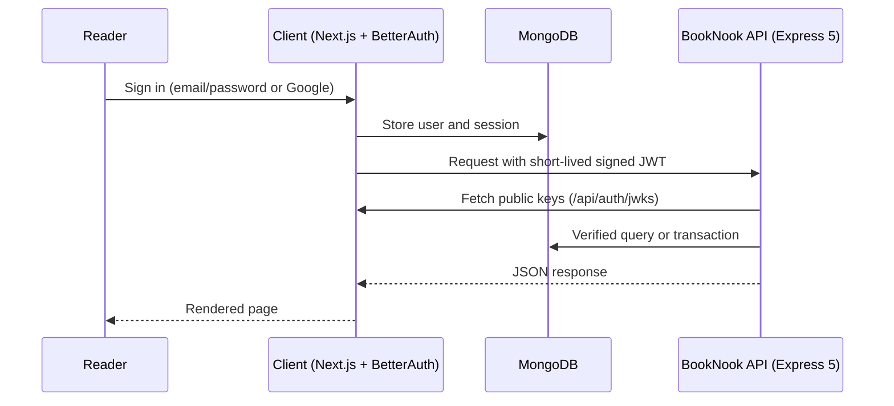

# BookNook Client

A responsive online library built with Next.js, where readers can browse a shared catalog, add their own books, and borrow or return copies. It authenticates with BetterAuth and talks to a separate Express + MongoDB API using signed JWTs.

[Overview](#overview) · [Architecture](#architecture) · [Features](#features) · [Getting Started](#getting-started) · [Deployment](#deployment)

| | |
| --- | --- |
| **Live site** | [booknook-website.vercel.app](https://booknook-website.vercel.app) |
| **API server** | [booknook-server-site](https://github.com/NSniha/booknook-server-site) |

---

## Table of Contents

1. [Overview](#overview)
2. [Architecture](#architecture)
3. [Tech Stack](#tech-stack)
4. [Features](#features)
5. [Routes](#routes)
6. [Authentication](#authentication)
7. [Design System](#design-system)
8. [Project Structure](#project-structure)
9. [Getting Started](#getting-started)
10. [Testing](#testing)
11. [Deployment](#deployment)
12. [Credits](#credits)
13. [Author](#author)

---

## Overview

BookNook is a reader-powered library: add a book, borrow a book, return a book. This repository is the client application, built with the Next.js App Router, Tailwind CSS and modern JavaScript. Authentication and sessions are handled inside Next.js by BetterAuth with its MongoDB adapter, and the same app issues short-lived signed JWTs that the separate Express API verifies.

The client and the API must use the same MongoDB database.

## Architecture



BetterAuth runs inside Next.js at `/api/auth/[...all]` and provides `/api/auth/token` and `/api/auth/jwks`. The Express API uses the public keys to verify every token before touching the database.

## Tech Stack


| Layer | Technology |
| --- | --- |
| Framework | Next.js (App Router) |
| Language | JavaScript (ES6+) |
| Styling | Tailwind CSS with centralized theme tokens |
| Authentication | BetterAuth, MongoDB adapter, Google OAuth, Ed25519 JWTs |
| Database | MongoDB Atlas (shared with the API) |
| Animation and UI | Swiper, Motion, Lucide icons |
| Typography | Inter and DM Sans, self-hosted via Fontsource |
| Image uploads | imgbb, with Postimages direct-link support |
| Hosting | Vercel |

## Features

**Interface**
- Responsive editorial design with a white, soft-beige and deep-green palette
- Accessible dark and light mode toggle
- Full-width three-slide Swiper hero and 13 homepage sections, including latest arrivals, category shelves, community collection, featured authors, reading rituals and a reading journal
- Scroll-reveal animations with reduced-motion support
- Toast feedback, loading spinners, empty and error states, per-route page titles and a custom 404 page

**Catalog**
- Search by title or author
- Category and availability filters, sorting and server-side pagination
- Three catalog cards per row on desktop

**Accounts**
- Email and password registration and login
- Google OAuth
- Persistent sessions and safe return-to-page redirects after login

**Library management**
- Private Add Book, Book Details, My Books, My Borrows and My Profile pages
- Real cover uploads through imgbb, plus Postimages direct links
- Prefilled book editing, a custom delete confirmation and owner-only controls
- Seven-day borrowing with due dates, returns, no duplicate active borrows and atomic stock accounting through the API
- Validated Total Copies and read-only user identity

## Routes

| Route | Access |
| --- | --- |
| `/` | Public |
| `/books` | Public |
| `/login`, `/register` | Public |
| `/books/[id]` | Signed-in reader |
| `/add-book` | Signed-in reader |
| `/my-books` | Signed-in reader |
| `/my-books/[id]/edit` | Owner |
| `/my-borrows` | Signed-in reader |
| `/profile` | Signed-in reader |

## Authentication

- BetterAuth stores users and sessions in MongoDB and signs short-lived Ed25519 JWTs for the Express API.
- Passwords need at least 6 characters with uppercase and lowercase letters, validated in both the form and the auth hook.
- Email sign-up redirects to Login. Google sign-up returns to Home.
- JWTs stay in request memory and are never saved in `localStorage`.
- Private pages validate the database-backed session before rendering, and client-side session loading never triggers a premature login redirect.
- Email verification and password reset are intentionally not included.
- Google secrets belong on the Next.js host only, never in `NEXT_PUBLIC_*` variables.

## Design System

| Element | Specification |
| --- | --- |
| Fonts | Inter and DM Sans |
| Hero heading | 40 to 68px |
| Route title | 40 to 56px |
| Section heading | 32 to 44px |
| Book title | 21 to 23px |
| Body and UI text | 16px (announcement bar 14px) |
| Content container | 1360px |
| Section spacing | 64px mobile, 96px desktop |

The type scale lives in Tailwind theme tokens. Each homepage section is its own component, shared shelves reuse a common `BookShelf` component, and a shared provider avoids repeated catalog downloads.

## Project Structure

```text
booknook-client-site/
├── public/images/        # Bundled images, including sample book covers
├── src/
│   ├── components/home/  # One component per homepage section
│   └── data/authors.js   # Author portrait and article source links
├── tests/                # Client tests
├── .env.example
├── jsconfig.json
├── next.config.mjs
├── postcss.config.mjs
└── package.json
```

## Getting Started

### Prerequisites

- Node.js 22.20+ or 24 LTS
- A MongoDB Atlas database shared with the [API server](https://github.com/NSniha/booknook-server-site)
- A running instance of the API server (default `http://localhost:5000`)
- Google OAuth credentials and an imgbb key for sign-in and image uploads

### Installation

```bash
git clone https://github.com/NSniha/booknook-client-site.git
cd booknook-client-site
npm ci
cp .env.example .env.local
```

### Environment variables

Fill in `.env.local`. `.env.example` lists every required key, including the MongoDB connection, the BetterAuth secret, the Google OAuth credentials and the imgbb key.

| Variable | Description |
| --- | --- |
| `BETTER_AUTH_URL` | Canonical origin of this client app |
| `NEXT_PUBLIC_SITE_URL` | Public site URL |
| `NEXT_PUBLIC_API_URL` | Base URL of the Express API |
| `NEXT_PUBLIC_GOOGLE_AUTH_ENABLED` | Set to `true` to show the Google sign-in option (real OAuth credentials are still required) |

For Google sign-in, set the authorized redirect URI to `<BETTER_AUTH_URL>/api/auth/callback/google`.

### Run

```bash
npm run dev
```

The app runs at [http://localhost:3000](http://localhost:3000).

### Scripts

| Command | Description |
| --- | --- |
| `npm run dev` | Start the development server |
| `npm run build` | Create a production build |
| `npm start` | Start the production server |
| `npm test` | Run the client tests (8) |

## Testing

```bash
npm test
```

The suite contains 8 client tests. Features that depend on external services, namely MongoDB, Google OAuth and imgbb uploads, need a configured environment to verify end to end.

## Deployment

Deployed on Vercel.

1. Import the repository into Vercel and select the **Next.js** framework preset.
2. Add every key from `.env.example` as an environment variable.
3. Set `BETTER_AUTH_URL` and `NEXT_PUBLIC_SITE_URL` to the final client origin, and `NEXT_PUBLIC_API_URL` to the Express host.
4. Update the API server's CORS origin and the Google callback URL to match.
5. Deploy.

Do not use static export. All nested routes are served by the Next.js server.

## Credits

- Book covers: publisher cover CDN, linked by ISBN (edition and cover sources are listed in the API server's seed data)
- Author portraits and article sources: listed in `src/data/authors.js`
- Journal photography: Unsplash
- Fonts: Inter and DM Sans via Fontsource
- Icons: Lucide
- Layout inspiration: Bokifa. All website copy is original.

## Author

**Nobonita Saha Niha**, Front-End Developer

[GitHub](https://github.com/NSniha) · [LinkedIn](https://www.linkedin.com/in/nobonita-saha-niha-04b501214/)