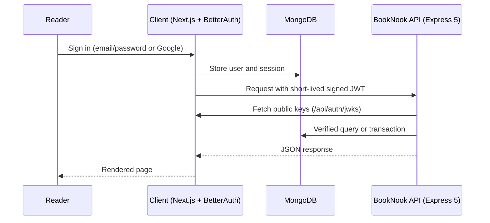

<div align="center">

<h1 align="center">
  &nbsp;BookNook — Online Book Library
</h1>

<h1 align="center">BookNook — Online Book Library</h1>

### Add a book. Borrow a book. Return a book.


[](https://booknook-website.vercel.app)
[](https://github.com/NSniha/booknook-server-site)

</div>

---

## 📖 About

**BookNook** is a reader-powered online library. Anyone can browse the shared catalog, and signed-in readers can add their own books, borrow available copies for seven days, and return them when they are done.

This repository is the **client application**, built with the Next.js App Router, Tailwind CSS and modern JavaScript. Authentication runs inside Next.js with **BetterAuth** (email/password and Google), and the app signs short-lived **Ed25519 JWTs** that the separate [Express + MongoDB API](https://github.com/NSniha/booknook-server-site) verifies on every protected request.

---

## Screenshots


---

## ✨ Features

<table>
  <tr>
    <td width="50%">
      <b> Editorial Interface</b><br />
      Responsive design in white, soft beige and deep green, with an accessible dark/light toggle, a three-slide Swiper hero and 13 homepage sections.
    </td>
    <td width="50%">
      <b> Smart Catalog</b><br />
      Search by title or author, filter by category and availability, sort results and browse with server-side pagination.
    </td>
  </tr>
  <tr>
    <td width="50%">
      <b> Secure Authentication</b><br />
      Email/password and Google sign-in with persistent BetterAuth sessions and safe return-to-page redirects.
    </td>
    <td width="50%">
      <b> Library Management</b><br />
      Add, edit and delete your own books with real cover uploads, validated copy counts and owner-only controls.
    </td>
  </tr>
  <tr>
    <td width="50%">
      <b>Borrow and Return</b><br />
      Seven-day borrowing with due dates, no duplicate active borrows and atomic stock accounting handled by the API.
    </td>
    <td width="50%">
      <b>Polished UX</b><br />
      Toast feedback, loading spinners, empty and error states, per-route page titles, a custom 404 page and reduced-motion support.
    </td>
  </tr>
</table>

---

## Tech Stack

<div align="center">


</div>

| Layer | Technology |
| --- | --- |
| Framework | Next.js (App Router) |
| Language | JavaScript (ES6+) |
| Styling | Tailwind CSS with centralized theme tokens |
| Authentication | BetterAuth, MongoDB adapter, Google OAuth, Ed25519 JWTs |
| Database | MongoDB Atlas (shared with the API) |
| UI and Motion | Swiper, Motion, Lucide icons |
| Typography | Inter and DM Sans, self-hosted via Fontsource |
| Image Uploads | imgbb, with Postimages direct-link support |
| Hosting | Vercel |

---

## Architecture



BetterAuth runs inside Next.js at `/api/auth/[...all]` and provides `/api/auth/token` and `/api/auth/jwks`. The client and the API must use the **same MongoDB database**.

---

## Routes

| Route | Access |
| --- | --- |
| `/` | Public |
| `/books` | Public |
| `/login`, `/register` | Public |
| `/books/[id]` | Signed-in reader |
| `/add-book` | Signed-in reader |
| `/my-books` | Signed-in reader |
| `/my-books/[id]/edit` | Owner only |
| `/my-borrows` | Signed-in reader |
| `/profile` | Signed-in reader |

---

## Authentication

- Users and sessions are stored in MongoDB through the BetterAuth adapter.
- Passwords need at least 6 characters with uppercase and lowercase letters, validated in both the form and the auth hook.
- Email sign-up redirects to Login. Google sign-up returns to Home.
- JWTs stay in request memory and are **never saved in `localStorage`**.
- Private pages validate the database-backed session before rendering, and client-side session loading never triggers a premature login redirect.
- Email verification and password reset are intentionally not included.
- Google secrets live on the Next.js host only, never in `NEXT_PUBLIC_*` variables.

---

## Design System

<details>
<summary><b>View typography and layout rules</b></summary>

<br />

| Element | Specification |
| --- | --- |
| Fonts | Inter and DM Sans |
| Hero heading | 40 to 68px |
| Route title | 40 to 56px |
| Section heading | 32 to 44px |
| Book title | 21 to 23px |
| Body and UI text | 16px (announcement bar 14px) |
| Content container | 1360px |
| Section spacing | 64px mobile, 96px desktop |

The type scale lives in Tailwind theme tokens. Every homepage section is its own component, shared shelves reuse one `BookShelf` component, and a shared provider avoids repeated catalog downloads.

</details>

---

## Project Structure

```text
booknook-client-site/
├── public/images/        # Bundled images, including sample book covers
├── src/
│   ├── components/home/  # One component per homepage section
│   └── data/authors.js   # Author portrait and article source links
├── tests/                # Client tests
├── .env.example
├── jsconfig.json
├── next.config.mjs
├── postcss.config.mjs
└── package.json
```

---

## Getting Started

### Prerequisites

- Node.js **22.20+** or **24 LTS**
- A MongoDB Atlas database shared with the [API server](https://github.com/NSniha/booknook-server-site)
- The API server running locally (default `http://localhost:5000`)
- Google OAuth credentials and an imgbb key for sign-in and image uploads

### Installation

```bash
git clone https://github.com/NSniha/booknook-client-site.git
cd booknook-client-site
npm ci
cp .env.example .env.local
npm run dev
```

The app runs at [http://localhost:3000](http://localhost:3000).

<details>
<summary><b>Environment variables</b></summary>

<br />

Fill in `.env.local`. `.env.example` lists every required key, including the MongoDB connection, the BetterAuth secret, the Google OAuth credentials and the imgbb key.

| Variable | Description |
| --- | --- |
| `BETTER_AUTH_URL` | Canonical origin of this client app |
| `NEXT_PUBLIC_SITE_URL` | Public site URL |
| `NEXT_PUBLIC_API_URL` | Base URL of the Express API |
| `NEXT_PUBLIC_GOOGLE_AUTH_ENABLED` | Set to `true` to show Google sign-in (real OAuth credentials are still required) |

For Google sign-in, set the authorized redirect URI to `<BETTER_AUTH_URL>/api/auth/callback/google`.

</details>

### Scripts

| Command | Description |
| --- | --- |
| `npm run dev` | Start the development server |
| `npm run build` | Create a production build |
| `npm start` | Start the production server |
| `npm test` | Run the client tests (8) |

---

## 🧪 Testing

```bash
npm test
```

The suite contains 8 client tests. Features that depend on external services (MongoDB, Google OAuth and imgbb uploads) need a configured environment to verify end to end.

---

## ☁️ Deployment

Deployed on **Vercel**.

1. Import the repository into Vercel and choose the **Next.js** preset.
2. Add every key from `.env.example` as an environment variable.
3. Set `BETTER_AUTH_URL` and `NEXT_PUBLIC_SITE_URL` to the final client origin, and `NEXT_PUBLIC_API_URL` to the Express host.
4. Update the API server's CORS origin and the Google callback URL to match.
5. Deploy.

> Do not use static export. All nested routes are served by the Next.js server.

---

## 🙏 Credits

- **Book covers:** publisher cover CDN, linked by ISBN (sources are in the API server's seed data)
- **Author portraits and articles:** source links in `src/data/authors.js`
- **Photography:** Unsplash
- **Fonts:** Inter and DM Sans via Fontsource
- **Icons:** Lucide
- **Layout inspiration:** Bokifa. All website copy is original.

---

## 👩‍💻 Author

<div align="center">

**Nobonita Saha Niha**
Front-End Developer · Design-to-Code Specialist

[](https://github.com/NSniha)
[](https://www.linkedin.com/in/nobonita-saha-niha-04b501214/)

⭐ If you like this project, please consider giving it a star.

</div>
